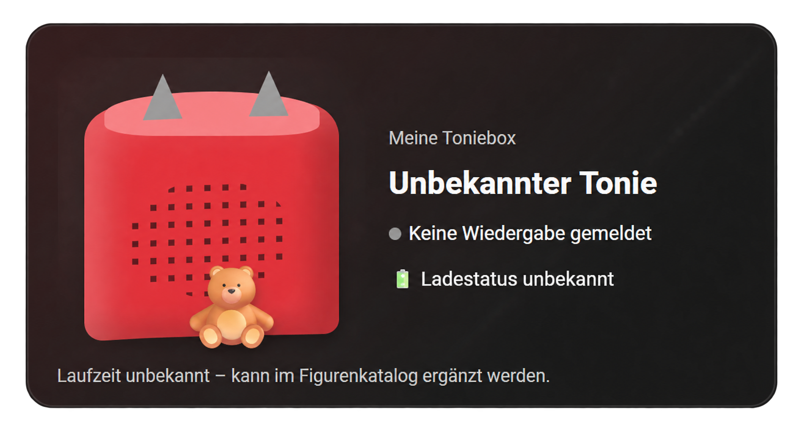
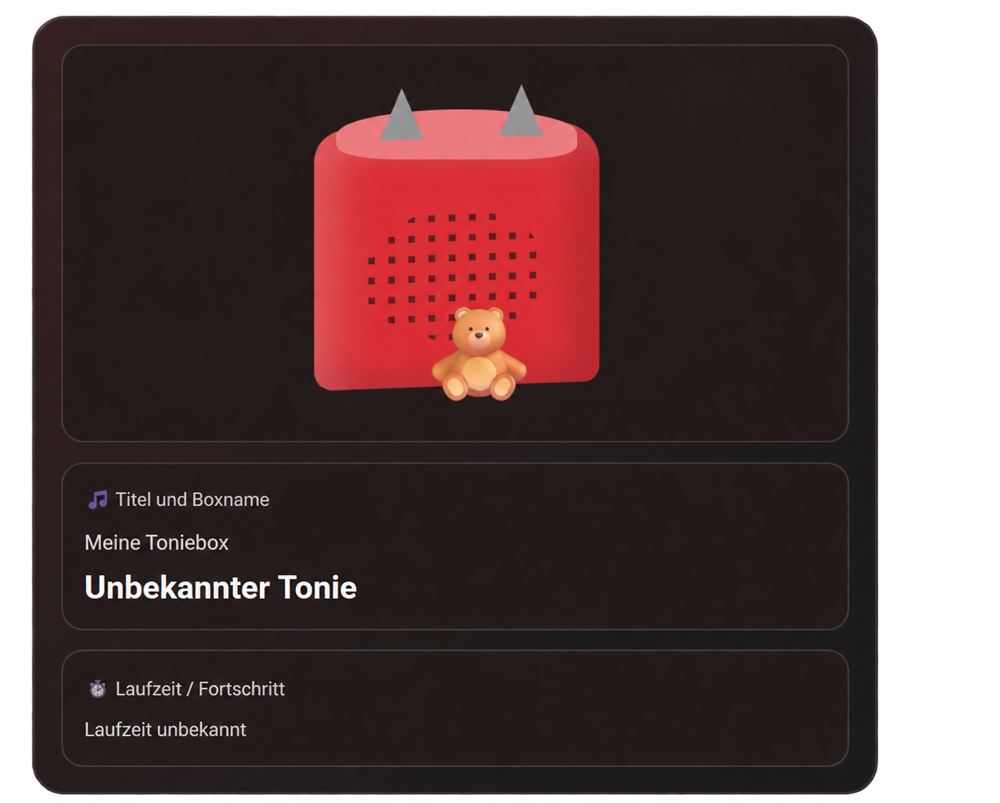
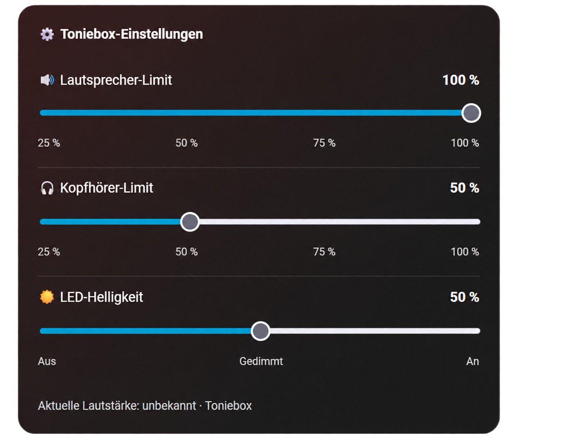

# 🧸 TeddyCloud Home Assistant Integration

**Deine Tonieboxen und deine Tonie-Sammlung direkt in Home Assistant.**

Zeige Wiedergabestatus, Figurenbilder und Laufzeiten an, verwalte Lautstärkelimits und LED-Helligkeit und gestalte dein Dashboard mit passenden Karten.

[](https://github.com/mirkohd1999/TeddyCloud-Home-Assistant-Integration/releases/latest)
[](LICENSE)

[](https://my.home-assistant.io/redirect/hacs_repository/?owner=mirkohd1999&repository=TeddyCloud-Home-Assistant-Integration&category=integration)

## Inhalt

- [Funktionen](#funktionen)
- [Installation](#installation)
- [Dashboard](#dashboard)
- [Selbst gestalten](#selbst-gestalten)
- [Tonie-Bibliothek](#tonie-bibliothek)
- [MQTT und Ohrtasten](#mqtt-und-ohrtasten)
- [Bilder und Laufzeit](#bilder-und-laufzeit)
- [Fehlerbehebung](#fehlerbehebung)
- [Updates und Support](#updates-und-support)

## Funktionen

| Bereich | Möglichkeiten |
| --- | --- |
| Tonieboxen | Automatisch über MQTT erkennen oder manuell hinzufügen; mehrere Boxen verwalten |
| Wiedergabe | Titel, Figurenbild, Wiedergabestatus und geschätzte Laufzeit anzeigen |
| Offline-Status | Ausbleibende Box-Aktivität erkennen und laufende Hörspiele anhand ihrer Laufzeit berücksichtigen |
| Lautstärke | Aktuelle Lautstärke ablesen sowie Lautsprecher- und Kopfhörerlimits einstellen |
| LED | Helligkeit auf aus, gedimmt oder an stellen |
| Status | Ladestationsstatus und Ohrtasten-Ereignisse anzeigen |
| Dashboard | Acht Vorlagen, Live-Vorschau und frei gestaltbare Bausteine |
| Bibliothek | Tonies automatisch sammeln, durchsuchen, sortieren und gemeinsam verwalten |
| Hörproben | Verfügbare Hörproben direkt im Dashboard starten und stoppen |
| Sprachen | Dashboard-Karten automatisch auf Deutsch oder Englisch anzeigen |

**Grenzen:** Play/Pause und die aktuelle Lautstärke der Toniebox lassen sich nicht fernsteuern. Ein verlässlicher Akku-Prozentstand und eine echte Abspielposition stehen nicht zur Verfügung. Der angezeigte Fortschritt ist geschätzt. Ein gemeldeter Ladestationsstatus bestätigt keinen aktiven Ladevorgang. Lautstärkelimits und LED-Einstellungen können erst beim nächsten *Freshness Check* der Toniebox wirksam werden.

## Installation

### Voraussetzungen

- Home Assistant mit eingerichteter [MQTT-Integration](https://www.home-assistant.io/integrations/mqtt/)
- Ein [TeddyCloud-Server](https://github.com/toniebox-reverse-engineering/teddycloud), der Toniebox-Daten an den MQTT-Broker sendet
- [HACS](https://www.hacs.xyz/) für die empfohlene Installation
- Internetzugriff, wenn Bilder, Laufzeiten und Hörproben aus dem Online-Katalog geladen werden sollen

Die Integration verwendet die vorhandene MQTT-Anbindung von Home Assistant. Zusätzliche MQTT-Zugangsdaten sind nicht erforderlich. Sie wird als **Integration** installiert, nicht als Add-on.

### Direkt über HACS

1. Klicke auf den **Open HACS Repository**-Button oben oder öffne HACS und suche nach **TeddyCloud Home Assistant Integration**.
2. Öffne den Treffer und lade die neueste veröffentlichte Version herunter.
3. **Starte Home Assistant neu.**
4. Öffne **Einstellungen → Geräte & Dienste → Integration hinzufügen**.
5. Suche nach **TeddyCloud Home Assistant Integration**.
6. Wähle **Automatisch suchen** oder **Manuell hinzufügen** und lege Boxname und Boxfarbe fest.

Schalte die Toniebox für die automatische Suche ein oder stelle eine Figur auf. Ohne MQTT-Meldung kann eine stille Box nicht zuverlässig erkannt werden. Alternativ kannst du die Box-ID manuell eintragen.

### Alternative: Benutzerdefiniertes Repository

Falls die Integration in deiner HACS-Suche nicht erscheint:

1. Öffne **HACS → ⋮ → Benutzerdefinierte Repositories**.
2. Trage diese Adresse ein:

   ```text
   https://github.com/mirkohd1999/TeddyCloud-Home-Assistant-Integration
   ```

3. Wähle den Typ **Integration** und füge das Repository hinzu.
4. Suche in HACS nach **TeddyCloud Home Assistant Integration** und lade die neueste veröffentlichte Version herunter.
5. Starte Home Assistant neu und richte die Integration unter **Einstellungen → Geräte & Dienste** ein.

### Manuell ohne HACS

1. Lade den Quellcode der [aktuellen Veröffentlichung](https://github.com/mirkohd1999/TeddyCloud-Home-Assistant-Integration/releases/latest) herunter.
2. Kopiere `custom_components/teddycloud_homeassistant` nach `/config/custom_components/`.
3. Starte Home Assistant neu und füge die Integration unter **Einstellungen → Geräte & Dienste** hinzu.

## Dashboard

Die Integration bindet ihre Kartenressource bei Storage-Dashboards nach Möglichkeit automatisch ein.

1. Öffne ein Dashboard und wähle **Bearbeiten → Karte hinzufügen**.
2. Wähle **TeddyCloud Home Assistant Integration**.
3. Wähle Toniebox und Vorlage. Bei genau einer passenden Box wird sie normalerweise automatisch ausgewählt.
4. Prüfe die Vorschau und speichere die Karte.

| Vorlage | Inhalt |
| --- | --- |
| **Alles** | Player und Toniebox-Einstellungen |
| **Musik** | Tonie-Bild und Titel |
| **Kompakt** | Platzsparende Leiste |
| **Großes Bild** | Bild, Titel und Laufzeit |
| **Kacheln** | Bild, Titel und Status als Kacheln |
| **Status** | Wiedergabe, Ladestation, Lautstärke und Ohrtasten |
| **Einstellungen** | Lautsprecherlimit, Kopfhörerlimit und LED |
| **Selbst gestalten** | Eigene Bausteine, Reihenfolge und Breiten |

### Einblicke

| Musik | Selbst gestalten | Einstellungen |
| :---: | :---: | :---: |
|  |  |  |

Anzeigename, Boxfarbe, Bilddarstellung und eine manuelle Entitäts-ID findest du im Karteneditor unter **Weitere Einstellungen (optional)**.

Die Player-Karte, die Tonie-Bibliothek und die Karteneditoren folgen der Sprache des Home-Assistant-Benutzerprofils. Bei einem englischen Profil erscheinen die Bedienelemente auf Englisch; andernfalls wird Deutsch verwendet. Hörspieltitel, Figurennamen und selbst vergebene Boxnamen werden nicht übersetzt.

## Selbst gestalten

Wähle im Karteneditor **Selbst gestalten**. Aktiviere die gewünschten Bausteine und sortiere sie mit **↑ / ↓**.

Verfügbar sind Bild/Toniebox, Titel und Boxname, Wiedergabestatus, Ladestation, Laufzeit/Fortschritt, aktuelle Lautstärke, Lautsprecherlimit, Kopfhörerlimit, LED-Helligkeit und Ohrtasten.

Für unterschiedliche Breiten:

1. Wähle unter **Anordnung** die Option **Kacheln**.
2. Stelle die Gesamtzahl der **Spalten** auf 1, 2 oder 3.
3. Wähle bei jedem aktiven Baustein **1 Spalte**, **2 Spalten** oder **Volle Breite**.
4. Prüfe die Vorschau und speichere die Karte.

Auf schmalen Bildschirmen werden die Kacheln automatisch untereinander angeordnet.

<details>
<summary>Optionales YAML-Beispiel</summary>

Der visuelle Editor erstellt die Konfiguration automatisch. Für eine manuelle Einrichtung:

```yaml
type: custom:teddycloud-homeassistant-card
entity: media_player.meine_toniebox
mode: custom
layout: grid
columns: 2
sections:
  - artwork
  - title
  - playback
  - charger
  - led
section_widths:
  artwork: 2
  title: 1
  playback: 1
  charger: 1
  led: 2
```

Ersetze die Beispiel-Entität durch deine tatsächliche ID unter **Einstellungen → Geräte & Dienste → Entitäten**. Weitere Baustein-Kennungen sind `progress`, `volume`, `speaker`, `headphone` und `ears`.

</details>

## Tonie-Bibliothek

**Deine Tonies – automatisch gesammelt und übersichtlich an einem Ort.**


Die Bibliothek ist eine eigene Dashboard-Karte. Gespeicherte Tonies bleiben sichtbar, auch wenn keine Toniebox eingeschaltet ist.

### Einrichten

Ein Dashboard-Administrator öffnet **Bearbeiten → Karte hinzufügen**, wählt **TeddyCloud Tonie-Bibliothek** und speichert die Karte.

Für eine manuelle Karte genügt:

```yaml
type: custom:teddycloud-tonie-library-card
```

### Sammeln und verwalten

- **Automatisch sammeln:** Sobald eine neue Audio-ID von einer Toniebox empfangen wird, wird der Tonie gespeichert.
- **System-Sounds ausblenden:** Erkannte Start-Jingles und Systemansagen erscheinen nicht in der Sammlung.
- **Sortieren:** Häufig gehörte Tonies stehen oben. Die Zahl basiert auf neuen Erkennungen beziehungsweise Aufstellungen.
- **Suchen:** Das Suchfeld filtert die gemeinsame Sammlung nach Titel.
- **Bearbeiten:** Administratoren können Titel, Laufzeit und Bild anpassen. Unterstützt werden Bildadressen sowie JPG-, PNG- und WebP-Uploads bis 2 MB.
- **Manuell hinzufügen:** Administratoren können Tonies mit einer Audio-ID ergänzen.
- **Löschen:** Angemeldete Nutzer können Einträge nach Bestätigung entfernen.

Die Audio-ID wird nicht auf den Kacheln angezeigt. Administratoren finden sie beim Bearbeiten unter **Technische Details**. Beim manuellen Hinzufügen ist sie ein Pflichtfeld.

### Hörproben direkt im Dashboard

Bei Tonies mit verfügbarer Hörprobe erscheint **▶ Hörprobe** direkt neben den anderen Aktionen der Kachel. Beim Start wechselt der Button zu **■ Stop**. Die Hörprobe wird auf dem Gerät abgespielt, auf dem das Dashboard geöffnet ist. Es gibt keinen zusätzlichen Player, Fortschrittsbalken, Zeitangaben oder ein Wiedergabemenü. Beim Start einer anderen Hörprobe oder beim Verlassen des Dashboards endet die aktuelle Wiedergabe. Es wird keine externe Webseite geöffnet.

Als einzige Quelle dient der [tonies-json-Katalog](https://github.com/toniebox-reverse-engineering/tonies-json). Die Audio-ID bestimmt die Hörprobe und damit Inhaltsfassung und Sprache. Ohne eindeutigen Katalogtreffer und hinterlegten Hörproben-Link erscheint kein Button.

Die Katalogdaten werden regelmäßig aktualisiert. Mit **Hörproben aktualisieren** kann der Abgleich für die vorhandene Sammlung zusätzlich manuell gestartet werden. Die Integration speichert nur den Link zur Hörprobe. Audiodateien werden weder heruntergeladen noch in Home Assistant oder TeddyCloud gespeichert. Der Browser lädt die Probe erst beim Abspielen direkt über HTTPS.

Hörproben stehen Administratoren und normalen angemeldeten Nutzern zur Verfügung. Sie werden nicht auf der Toniebox abgespielt und verändern weder die Häufigkeit noch die Markierung der zuletzt gehörten Figur.

### Häufigkeit, letzte Figur und doppelte Einträge

Die am häufigsten erkannten Tonies stehen oben. Zwischengespeicherte MQTT-Meldungen erhöhen den Zähler nicht.

Der zuletzt erkannte Tonie jeder Box erhält einen Rahmen in der eingestellten Boxfarbe. Nutzen mehrere Boxen denselben Tonie zuletzt, werden mehrere Farbringe angezeigt. System-Sounds ersetzen dabei keine echte Figur.

Audio-IDs, die der Katalog eindeutig demselben Inhalt zuordnet, werden als eine Karte dargestellt. Zähler werden zusammengeführt und eigene Angaben bevorzugt. Gleiche Titel allein reichen nicht zum Zusammenführen, damit unterschiedliche Folgen getrennt bleiben.

### Berechtigungen

| Aktion | Administratoren | Normale angemeldete Nutzer |
| --- | :---: | :---: |
| Sammlung ansehen und durchsuchen | ✓ | ✓ |
| Hörproben im Dashboard abspielen | ✓ | ✓ |
| Tonies löschen | ✓ | ✓ |
| Tonies manuell hinzufügen | ✓ | — |
| Titel, Laufzeit und Bilder bearbeiten | ✓ | — |

Alle angemeldeten Nutzer sehen dieselbe gemeinsame Sammlung. Änderungen gelten für das gesamte Home-Assistant-System. Bearbeitungsrechte werden serverseitig geprüft; anonyme Nutzer haben keinen Zugriff.

Die Sammlung entsteht aus den empfangenen Erkennungsdaten. Eine vollständige frühere Nutzungshistorie der Toniebox kann nicht nachträglich eingelesen werden. Fehlende Figuren kannst du erneut aufstellen oder als Administrator manuell ergänzen. Eigene Angaben werden nicht durch Katalogdaten überschrieben.

## MQTT und Ohrtasten

Die Toniebox meldet ihre Daten über TeddyCloud und den MQTT-Broker an Home Assistant. Die Topics folgen diesem Schema:

```text
<MQTT-Präfix>/box/<Box-ID>/<Feld>
```

Beispiel: `teddyCloud/box/DEINE_BOX_ID/Playback`. Das Präfix wird bei der Suche erkannt oder manuell eingestellt; Standard ist `teddyCloud`.

Pro Box stellt die Integration einen lesenden Media-Player, Einstellungen für Lautsprecherlimit, Kopfhörerlimit und LED sowie Sensoren für die aktuelle Lautstärke und beide Ohrtasten bereit. Name und Farbe lassen sich unter **Einstellungen → Geräte & Dienste → TeddyCloud Home Assistant Integration → Konfigurieren** ändern.

| Ohrtaste | MQTT-Feld |
| --- | --- |
| Großes Ohr | `VolUp` |
| Kleines Ohr | `VolDown` |

Die Sensoren erkennen einfachen, doppelten und dreifachen Tastendruck. Die Attribute `last_pressed` und `press_count` zeigen Zeitpunkt und Ereigniszähler seit dem Laden des Sensors. Wiederholte gleiche Tastendrücke zählen ebenfalls; gespeicherte Retained-Meldungen zählen nicht als neue Ereignisse.

Für Automationen kannst du auf Änderungen von `press_count` reagieren. Die Sensoren melden die Bedienung an der Box, steuern aber nicht ihre aktuelle Lautstärke.

## Bilder und Laufzeit

Die Integration sucht anhand der Audio-ID nach Bildern, Laufzeiten und Hörproben im [Tonies-Katalog](https://github.com/toniebox-reverse-engineering/tonies-json). Fehlt ein eindeutiger Treffer, erscheint ein Ersatzbild oder **Laufzeit unbekannt**. Administratoren können die Angaben in der Bibliothek ergänzen.

### Geschützte Bildspeicherung

Figurenbilder und eigene Bibliotheks-Uploads liegen unter `/config/.storage/teddycloud_homeassistant/images/` und werden nicht öffentlich über `/local/` bereitgestellt. Die Integration liefert sie über einen authentifizierten Home-Assistant-Endpunkt aus. Die Dashboard-Karten verwenden kurzlebige signierte Bildadressen und erneuern diese automatisch.

Die Bildsuche für MQTT und Statusanzeigen arbeitet mit einem Speicherindex. Dateizugriffe laufen im Home-Assistant-Executor, damit langsame Speichermedien den Home-Assistant-Ereignisloop nicht blockieren.

Bewusst hinterlegte externe Bildadressen und eigene `/local/`-Dateien außerhalb der Integrationsverzeichnisse bleiben unter deiner Kontrolle und werden nicht verändert.

Wenn TeddyCloud nicht erreichbare Bildadressen wie `http://localhost/...` meldet, prüfe in den Integrationsoptionen die **TeddyCloud-Adresse für Coverbilder**.

## Fehlerbehebung

### Erkennung beim Figurenwechsel

Titel- und Bildmeldungen werden kurz gesammelt, damit unterschiedlich schnell eintreffende MQTT-Nachrichten gemeinsam verarbeitet werden. Beim Abnehmen wird die aktuelle Zuordnung geleert; gespeicherte Figuren bleiben in der Bibliothek erhalten. Eigene Titel und eindeutige Katalogtreffer haben Vorrang. Unklare oder widersprüchliche MQTT-Meldungen überschreiben keine bekannten Zuordnungen.

Wenn eine Audio-ID nicht eindeutig erkannt wird, kann sie vorübergehend ohne Titel oder Bild erscheinen. Gleiche Titel allein führen nicht zum Zusammenführen oder Löschen von Einträgen.

### Toniebox offline

Die Offline-Erkennung verwendet den von TeddyCloud gemeldeten Zeitpunkt **LastSeen**. Wiederholte Meldungen mit demselben alten Zeitpunkt halten die Box nicht online. Fehlt ein gültiger LastSeen-Wert, dient der Empfang frischer MQTT-Meldungen als Ersatz.

Bei einem neu erkannten Wiedergabestart bleibt die Box mit bekannter Tonie-Laufzeit bis zum **geschätzten Ende plus 2 Minuten Puffer** online. Wiederholte „spielt“-Meldungen starten diese Frist nicht neu. Beim Abnehmen der Figur oder bei einer Stop-Meldung endet der Laufzeitschutz.

Die normale Wartezeit beträgt **5 Minuten** und lässt sich pro Box unter **Einstellungen → Geräte & Dienste → TeddyCloud Home Assistant Integration → Konfigurieren → Offline nach ausbleibender Box-Aktivität** auf **1 bis 120 Minuten** einstellen. Danach zeigt die Karte **Toniebox offline**. Die gewählte Boxfarbe bleibt in der Offline-Anzeige erhalten.

Die Anzeige ist eine Schätzung. Wird die Box während eines Hörspiels ausgeschaltet, kann sie bis zum geschätzten Ende als online erscheinen. Ohne bekannte Laufzeit gilt nur die eingestellte Aktivitätsfrist.

### Toniebox wird nicht gefunden

Schalte die Box ein oder stelle eine Figur auf. Prüfe, ob MQTT-Meldungen unter dem passenden Präfix und der richtigen Box-ID eintreffen. Bei Bedarf kannst du die Box-ID manuell hinzufügen.

### Karte fehlt oder wird nicht geladen

Starte Home Assistant nach der Installation neu und lade das Dashboard neu. Bei Storage-Dashboards verwaltet die Integration ihre Kartenressource automatisch. Bei YAML-verwalteten Ressourcen muss die von der Integration bereitgestellte JavaScript-Modul-Adresse manuell eingetragen werden.

Für die Bibliothek lautet der Kartentyp `custom:teddycloud-tonie-library-card`, für die Toniebox `custom:teddycloud-homeassistant-card`.

### Bibliothek bleibt leer

Stelle eine Figur auf eine eingeschaltete Toniebox. Prüfe in **Entwicklerwerkzeuge → Zustände**, ob die Media-Player-Entität eine `content_audio_id` empfängt. Ohne Erkennungsdaten kann die Integration keinen Tonie automatisch aufnehmen.

### Bild, Titel oder Laufzeit fehlen

Prüfe die Media-Player-Attribute `content_audio_id`, `catalog_status`, `catalog_match`, `cover_url`, `media_duration` und `duration_source`. Weitere Hinweise stehen unter **Einstellungen → System → Protokolle**. „Zustand setzen“ ersetzt keine empfangenen MQTT-Daten.

### Einstellungen werden nicht sofort übernommen

Die Regler ändern Lautstärkelimits und LED-Helligkeit. Befehle können erst beim nächsten *Freshness Check* wirksam werden. Die Rückmeldung der Box bestätigt die Änderung.

## Updates und Support

**Aktualisieren:** Installiere die angebotene Version über HACS, starte Home Assistant neu und lade das Dashboard auf den verwendeten Geräten neu.

**Vollständig entfernen:** Entferne als Administrator zuerst die TeddyCloud-Integration unter **Einstellungen → Geräte & Dienste** und deinstalliere sie anschließend in HACS. Beim Entfernen der letzten konfigurierten Box werden Bibliothek, eigene Titel, Uploads, Figurenarchiv, Integrations-Metadaten und automatisch verwaltete TeddyCloud-Kartenressourcen gelöscht. Laufende Hintergrundaufgaben werden vorher beendet. Sind weitere Boxen eingerichtet, bleiben die gemeinsam benötigten Daten bestehen.

Persönlich erstellte Dashboard-Konfigurationen und manuelle YAML-Ressourcen werden nicht automatisch verändert. Fremde Bilder und Ressourcen bleiben erhalten.

**Fragen und Fehler:** [GitHub-Issue öffnen](https://github.com/mirkohd1999/TeddyCloud-Home-Assistant-Integration/issues). Bitte Home-Assistant-, TeddyCloud- und Integrationsversion sowie relevante Fehlermeldungen nennen. Veröffentliche keine Passwörter oder Tokens.

Inoffizielle Community-Integration, kein offizielles Produkt von tonies® oder TeddyCloud. Die Rechte an Bildern und Katalogdaten liegen bei den jeweiligen Rechteinhabern.

**Lizenz:** [MIT](LICENSE) · **Downloads:** [Aktuelle Veröffentlichung](https://github.com/mirkohd1999/TeddyCloud-Home-Assistant-Integration/releases/latest)
