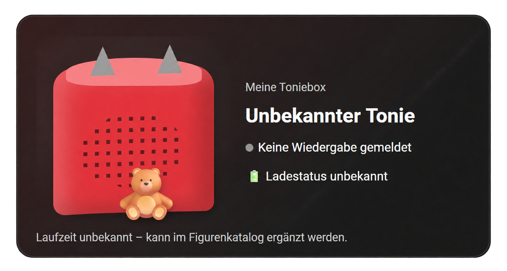
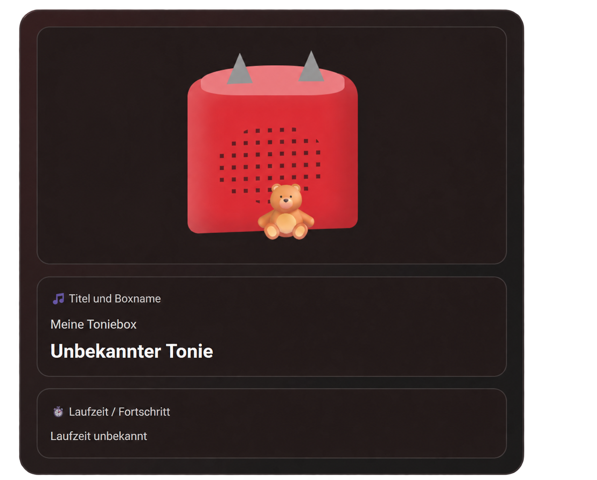
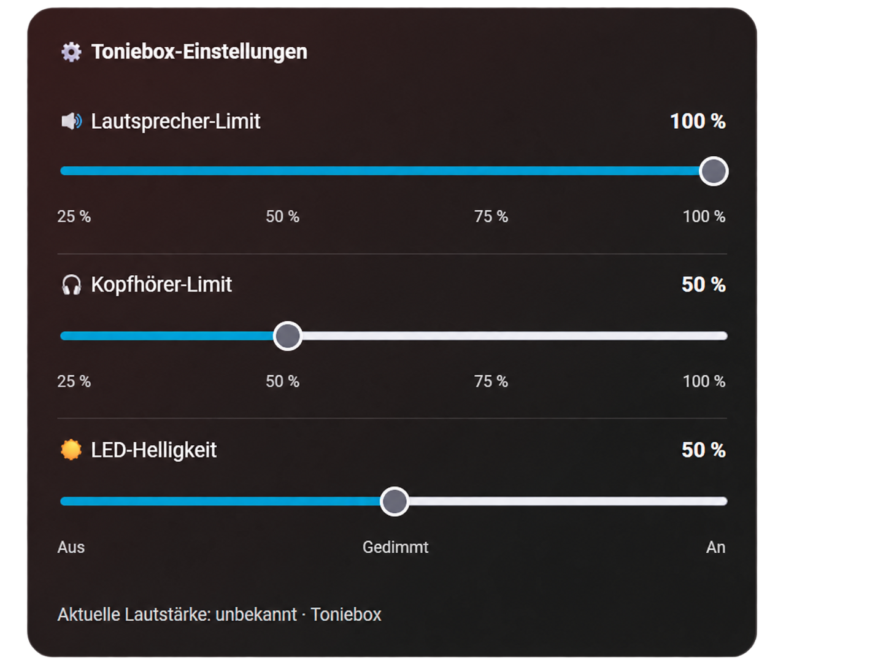
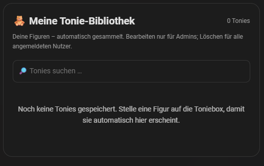

# 🧸 TeddyCloud Home Assistant Integration

**Deine Tonieboxen und deine Tonie-Sammlung direkt in Home Assistant.**

Zeige Wiedergabestatus, Figurenbilder und Laufzeiten an, stelle Lautstärkelimits und LED-Helligkeit ein und gestalte dein Dashboard mit passenden Karten.

[](https://github.com/mirkohd1999/TeddyCloud-Home-Assistant-Integration/releases/latest)
[](LICENSE)

## Inhalt

- [Funktionen](#funktionen)
- [Installation](#installation)
- [Dashboard](#dashboard)
- [Selbst gestalten](#selbst-gestalten)
- [Tonie-Bibliothek](#tonie-bibliothek)
- [MQTT und Ohrtasten](#mqtt-und-ohrtasten)
- [Bilder und Laufzeit](#bilder-und-laufzeit)
- [Fehlerbehebung](#fehlerbehebung)
- [Updates und Support](#updates-und-support)

## Funktionen

| Bereich | Möglichkeiten |
| --- | --- |
| Tonieboxen | Automatisch über MQTT erkennen oder manuell hinzufügen; mehrere Boxen verwalten |
| Wiedergabe | Gemeldeten Titel, Figurenbild und Wiedergabestatus anzeigen |
| Laufzeit | Kataloglaufzeit und geschätzten Fortschritt anzeigen |
| Lautstärke | Aktuelle Lautstärke ablesen; Lautsprecher- und Kopfhörerlimits einstellen |
| LED | Aus, gedimmt oder an |
| Status | Gemeldeten Ladestationsstatus und Ohrtasten-Ereignisse ansehen |
| Dashboard | Acht Vorlagen, Live-Vorschau und frei gestaltbare Bausteine |
| Bibliothek | Tonies automatisch sammeln, suchen und gemeinsam ansehen |

**Grenzen:** Play/Pause und die aktuelle Lautstärke lassen sich nicht fernsteuern. Ein verlässlicher Akku-Prozentstand und eine echte Abspielposition stehen nicht zur Verfügung. Der Fortschritt ist geschätzt. Ein erkannter Ladestationsstatus bestätigt keinen aktiven Ladevorgang. Lautstärkelimits und LED-Einstellungen können erst beim nächsten *Freshness Check* der Toniebox wirksam werden.

## Installation

### Voraussetzungen

- Home Assistant mit eingerichteter [MQTT-Integration](https://www.home-assistant.io/integrations/mqtt/).
- Ein [TeddyCloud-Server](https://github.com/toniebox-reverse-engineering/teddycloud), der Toniebox-Daten an den MQTT-Broker sendet.
- [HACS](https://www.hacs.xyz/) für die Installation.
- Internetzugriff, wenn Bilder und Laufzeiten aus dem Online-Katalog geladen werden sollen.

Die Integration verwendet die vorhandene MQTT-Anbindung von Home Assistant. Du musst hier keine weiteren MQTT-Zugangsdaten eingeben. Sie wird als **Integration** installiert, nicht als Add-on.

### Über HACS installieren

1. Öffne **HACS → ⋮ → Benutzerdefinierte Repositories**.
2. Trage diese Adresse ein und wähle den Typ **Integration**:

   ```text
   https://github.com/mirkohd1999/TeddyCloud-Home-Assistant-Integration
   ```

3. Lade **TeddyCloud Home Assistant Integration** herunter.
4. **Starte Home Assistant neu.**
5. Öffne **Einstellungen → Geräte & Dienste → Integration hinzufügen** und suche nach **TeddyCloud Home Assistant Integration**.
6. Wähle **Automatisch suchen** oder **Manuell hinzufügen**. Lege Boxname und Boxfarbe fest.

Schalte die Toniebox für die Suche ein oder stelle eine Figur auf. Ohne MQTT-Meldung kann eine stille Box nicht zuverlässig erkannt werden. Alternativ kannst du ihre Box-ID manuell eintragen.

**Manuell installieren:** Kopiere `custom_components/teddycloud_homeassistant` nach `/config/custom_components/` und starte Home Assistant neu.

## Dashboard

Die Integration bindet ihre Kartenressource bei Storage-Dashboards nach Möglichkeit automatisch ein.

1. Dashboard öffnen und **Bearbeiten → Karte hinzufügen** wählen.
2. **TeddyCloud Home Assistant Integration** auswählen.
3. Toniebox und Vorlage wählen. Bei genau einer passenden Box wird diese normalerweise automatisch ausgewählt.
4. Vorschau prüfen und **Speichern**.

| Vorlage | Inhalt |
| --- | --- |
| **Alles** | Player und Toniebox-Einstellungen |
| **Musik** | Tonie-Bild und Titel |
| **Kompakt** | Platzsparende Leiste |
| **Großes Bild** | Bild, Titel und Laufzeit |
| **Kacheln** | Bild, Titel und Status als Kacheln |
| **Status** | Wiedergabe, Ladestation, Lautstärke und Ohren |
| **Einstellungen** | Lautsprecherlimit, Kopfhörerlimit und LED |
| **Selbst gestalten** | Eigene Bausteine, Reihenfolge und Breiten |

### Einblicke

| Musik | Selbst gestalten | Einstellungen |
| :---: | :---: | :---: |
|  |  |  |

Anzeigename, Boxfarbe, Bilddarstellung und eine manuelle Entitäts-ID findest du im Karteneditor unter **Weitere Einstellungen (optional)**.

## Selbst gestalten

Wähle im Karteneditor **Selbst gestalten**. Aktiviere die gewünschten Bausteine per Häkchen und sortiere sie mit **↑ / ↓**.

Verfügbar sind Bild/Toniebox, Titel und Boxname, Wiedergabestatus, Ladestation, Laufzeit/Fortschritt, aktuelle Lautstärke, Lautsprecherlimit, Kopfhörerlimit, LED-Helligkeit und Ohrtasten.

Für unterschiedliche Breiten:

1. Unter **Anordnung** die Option **Kacheln** wählen.
2. Die Gesamtzahl der **Spalten** auf 1, 2 oder 3 einstellen.
3. Bei jedem aktiven Baustein seine Breite wählen: **1 Spalte**, **2 Spalten** oder **Volle Breite**, abhängig von der Gesamtspaltenzahl.
4. Vorschau prüfen und speichern.

So kann beispielsweise das Bild über zwei Spalten gehen und die LED-Einstellung die volle Breite nutzen. Auf schmalen Bildschirmen stehen die Kacheln untereinander.

<details>
<summary>Optionales YAML-Beispiel</summary>

Der visuelle Editor erstellt die Konfiguration automatisch. Für die manuelle Einrichtung:

```yaml
type: custom:teddycloud-homeassistant-card
entity: media_player.meine_toniebox
mode: custom
layout: grid
columns: 2
sections:
  - artwork
  - title
  - playback
  - charger
  - led
section_widths:
  artwork: 2
  title: 1
  playback: 1
  charger: 1
  led: 2
```

Ersetze die Beispiel-Entität durch deine tatsächliche ID unter **Einstellungen → Geräte & Dienste → Entitäten**. Weitere Baustein-Kennungen sind `progress`, `volume`, `speaker`, `headphone` und `ears`.

</details>

## Tonie-Bibliothek

**Deine Tonies – automatisch gesammelt und übersichtlich an einem Ort.**



Die Bibliothek ist eine eigene Dashboard-Karte. Gespeicherte Tonies bleiben sichtbar, auch wenn keine Toniebox eingeschaltet ist.

### Einrichten

Ein Dashboard-Administrator öffnet **Bearbeiten → Karte hinzufügen**, wählt **TeddyCloud Tonie-Bibliothek** und speichert die Karte. Weitere YAML-Einstellungen sind nicht nötig.

Für eine manuelle Karte genügt:

```yaml
type: custom:teddycloud-tonie-library-card
```

### Sammeln und verwalten

- **System-Sounds ausblenden:** Als „System sounds“ erkannte Start-Jingles und Systemansagen erscheinen nicht in der Sammlung; das gilt auch für bereits gespeicherte Einträge.
- **Automatisch sammeln:** Sobald die Integration eine neue Audio-ID von einer Toniebox empfängt, wird der Tonie gespeichert. Zum Start eine Figur auf die eingeschaltete Box stellen.
- **Suchen:** Die Sammlung über das Suchfeld filtern. Die Kacheln zeigen Bild, Titel und Laufzeit.
- **Bearbeiten:** Administratoren können Titel und Laufzeit in Minuten anpassen sowie eine Bildadresse hinterlegen oder ein JPG-, PNG- oder WebP-Bild bis 2 MB hochladen.
- **Manuell hinzufügen:** Administratoren können über **+ Tonie hinzufügen** einen Eintrag mit Audio-ID anlegen.
- **Löschen:** Angemeldete Nutzer können Einträge nach Bestätigung entfernen. Wird die Figur abgenommen und erneut erkannt, kann sie wieder zur Sammlung hinzugefügt werden.

Die Audio-ID wird nicht in den Kacheln angezeigt. Beim Bearbeiten findest du sie unter den eingeklappten **Technischen Details**. Beim manuellen Hinzufügen ist sie ein Pflichtfeld.

### Häufigkeit, letzte Figur und doppelte Einträge

Die häufigsten Tonies stehen oben. Gezählt werden neue Erkennungen/Aufstellungen, keine vollständig gehörten Durchläufe. Zwischengespeicherte MQTT-Meldungen erhöhen den Zähler nicht.

Der zuletzt erkannte Tonie jeder Box erhält einen Rahmen in deren eingestellter Farbe. Nutzen mehrere Boxen denselben Tonie zuletzt, erscheinen mehrere Farbringe. Diese Zuordnung bleibt nach einem Neustart gespeichert; sie entsteht ab der nächsten neuen Erkennung. System-Sounds verdrängen keinen echten Tonie als letzte Figur.

Audio-IDs, die der Online-Katalog ausdrücklich demselben Inhalt zuordnet, erscheinen als eine Karte. Zähler werden summiert und eigene Angaben bevorzugt. Die Originaldaten bleiben intern erhalten. Gleiche Titel allein reichen nicht zum Zusammenführen; unterschiedliche Folgen bleiben getrennt. Beim Start wird die vorhandene Sammlung im Hintergrund mit dem Katalog abgeglichen. Ohne erreichbaren Katalog oder eindeutige Zuordnung können doppelte Einträge zunächst bestehen bleiben.

### Berechtigungen

| Aktion | Administratoren | Normale angemeldete Nutzer |
| --- | :---: | :---: |
| Sammlung ansehen und durchsuchen | ✓ | ✓ |
| Tonies löschen | ✓ | ✓ |
| Tonies manuell hinzufügen | ✓ | — |
| Titel, Laufzeit und Bilder bearbeiten | ✓ | — |

Alle Nutzer sehen dieselbe gemeinsame Sammlung. Änderungen gelten für das gesamte Home-Assistant-System. Das Bearbeitungsrecht wird serverseitig geprüft; anonyme Nutzer haben keinen Zugriff.

Die Sammlung entsteht aus den empfangenen Erkennungsdaten. Eine vollständige Nutzungshistorie der Toniebox kann nicht nachträglich eingelesen werden. Fehlende Figuren kannst du erneut aufstellen oder als Administrator manuell ergänzen. Eigene Angaben werden nicht durch abweichende Katalogdaten überschrieben.

## MQTT und Ohrtasten

Die Toniebox meldet ihre Daten über TeddyCloud und den MQTT-Broker an Home Assistant. Die Topics folgen diesem Schema:

```text
<MQTT-Präfix>/box/<Box-ID>/<Feld>
```

Beispiel: `teddyCloud/box/DEINE_BOX_ID/Playback`. Das Präfix wird bei der Suche erkannt oder manuell eingestellt; Standard ist `teddyCloud`.

Pro Box stellt die Integration einen lesenden Media-Player, Einstellungen für Lautsprecherlimit, Kopfhörerlimit und LED sowie Sensoren für die aktuelle Lautstärke und beide Ohrtasten bereit. Name und Farbe lassen sich unter **Einstellungen → Geräte & Dienste → TeddyCloud Home Assistant Integration → Konfigurieren** ändern.

| Ohrtaste | MQTT-Feld |
| --- | --- |
| Großes Ohr | `VolUp` |
| Kleines Ohr | `VolDown` |

Die Sensoren erkennen einfachen, doppelten und dreifachen Tastendruck. Die Attribute `last_pressed` und `press_count` zeigen Zeitpunkt und Ereigniszähler seit dem Laden des Sensors. Wiederholte gleiche Tastendrücke zählen ebenfalls; gespeicherte Retained-Meldungen zählen nicht als neue Tastendrücke.

Für Automationen kannst du auf Änderungen von `press_count` reagieren. Diese Sensoren melden die Bedienung an der Box; sie steuern nicht deren aktuelle Lautstärke.

## Bilder und Laufzeit

Die Integration sucht anhand der Audio-ID nach Bildern und Laufzeiten im [Tonies-Katalog](https://github.com/toniebox-reverse-engineering/tonies-json). Fehlt ein Treffer, erscheint ein Ersatzbild oder **„Laufzeit unbekannt“**. Administratoren können die Angaben in der Bibliothek ergänzen.

Heruntergeladene Figurenbilder liegen bei Bedarf unter `/config/www/teddycloud_homeassistant/figures/`. Eigene Bibliotheks-Uploads werden unter `/config/www/teddycloud_homeassistant/library/` gespeichert.

Wenn TeddyCloud nicht erreichbare Bildadressen wie `http://localhost/...` meldet, prüfe in den Integrationsoptionen die **TeddyCloud-Adresse für Coverbilder**.

## Fehlerbehebung

### Sprache der Dashboard-Karten

Die Player-Karte, Tonie-Bibliothek und Karteneditoren folgen automatisch der Sprache deines Home-Assistant-Profils. Bei **Englisch** (auch `en-GB` und `en-US`) erscheinen die Bedienelemente auf Englisch. Bei Deutsch und anderen Sprachen bleibt Deutsch die Standardsprache. Die Browsersprache wird dafür nicht verwendet.

Jeder Nutzer sieht seine eigene Sprache. Hörspieltitel, Figurennamen und selbst vergebene Boxnamen werden nicht übersetzt. Eine zusätzliche Einstellung in der Karte ist nicht nötig.

### Toniebox offline

Die Offline-Erkennung verwendet den von TeddyCloud gemeldeten Zeitpunkt **LastSeen**. Wiederholte MQTT-Meldungen mit demselben alten Zeitpunkt halten die Box nicht online. Fehlt ein gültiger LastSeen-Wert, dient der Empfang frischer MQTT-Meldungen als Ersatz.

Bei einem neu erkannten Wiedergabestart bleibt die Box mit bekannter Tonie-Laufzeit bis zum **geschätzten Ende plus 2 Minuten Puffer** online. Die Laufzeit stammt aus deinen Bibliotheksangaben, der manuellen Zuordnung oder dem Online-Katalog. Wiederholtes „spielt“ startet diesen Schutz nicht neu. Beim Abnehmen der Figur oder bei einer Stop-Meldung endet der Laufzeitschutz; die normale Wartezeit beginnt.

Die normale Wartezeit beträgt **5 Minuten** und lässt sich pro Box unter **Einstellungen → Geräte & Dienste → TeddyCloud Home Assistant Integration → Konfigurieren → Offline nach ausbleibender Box-Aktivität** auf **1 bis 120 Minuten** einstellen. Danach zeigt die Karte **„Toniebox offline“**. Ein aktueller LastSeen-Wert stellt den Online-Status wieder her.

Die Anzeige bleibt eine Schätzung: Ausschalten während eines Hörspiels kann bis zum geschätzten Ende unbemerkt bleiben. Ohne bekannte Laufzeit gilt nur die Aktivitätsfrist. Nach einem HA-Neustart wird aus gespeicherten „spielt“-Meldungen kein neuer Wiedergabestart erfunden; ein bereits laufendes Hörspiel erhält deshalb erst beim nächsten neu erkannten Start wieder Laufzeitschutz. Live-Streams und manuelles Springen können nicht zuverlässig über die Gesamtlaufzeit geschätzt werden.

### Toniebox wird nicht gefunden

Box einschalten oder eine Figur aufstellen. Prüfe, ob MQTT-Meldungen unter dem passenden Präfix und der richtigen Box-ID eintreffen. Bei Bedarf die Box manuell hinzufügen.

### Karte fehlt oder wird nicht geladen

Home Assistant nach der Installation neu starten und das Dashboard neu laden. Prüfe unter **Einstellungen → Dashboards → Ressourcen**, ob die Kartenressource als **JavaScript-Modul** eingebunden ist:

```text
/teddycloud-homeassistant/card-v054.js?v=0.5.4
```

Bei YAML-verwalteten Ressourcen muss diese Adresse dort eingetragen werden. Vorhandene Einträge bearbeiten und doppelte Einträge vermeiden.

Für die Bibliothek lautet der Kartentyp `custom:teddycloud-tonie-library-card`, für die Toniebox `custom:teddycloud-homeassistant-card`.

### Bibliothek bleibt leer

Eine Figur auf eine eingeschaltete Toniebox stellen. Prüfe in **Entwicklerwerkzeuge → Zustände**, ob die Media-Player-Entität eine `content_audio_id` empfängt. Ohne Erkennungsdaten kann die Integration keinen Tonie automatisch aufnehmen.

### Bild, Titel oder Laufzeit fehlen

Prüfe die Media-Player-Attribute `content_audio_id`, `catalog_status`, `catalog_match`, `cover_url`, `media_duration` und `duration_source`. Weitere Hinweise stehen unter **Einstellungen → System → Protokolle**. „Zustand setzen“ ersetzt keine empfangenen MQTT-Daten.

### Einstellungen werden nicht sofort übernommen

Die Regler ändern Lautstärkelimits und LED-Helligkeit. Befehle können erst beim nächsten *Freshness Check* wirksam werden. Prüfe die MQTT-Befehls- und Statusmeldungen; erst die Rückmeldung der Box bestätigt eine Änderung.

## Updates und Support

**Aktualisieren:** Die angebotene Version in HACS herunterladen, Home Assistant neu starten und das Dashboard auf allen verwendeten Geräten neu laden.

**Entfernen:** Die Integration unter **Einstellungen → Geräte & Dienste** entfernen. Beim Entfernen der letzten Box werden integrationsinterne Figurenbilder und eindeutig von der Integration angelegte Ressourcen bereinigt. Selbst angelegte Dashboard-Karten und manuelle Ressourcen bleiben bestehen.

**Fragen und Fehler:** [GitHub-Issue öffnen](https://github.com/mirkohd1999/TeddyCloud-Home-Assistant-Integration/issues). Bitte Home-Assistant-, TeddyCloud- und Integrationsversion sowie relevante Fehlermeldungen nennen. Keine Passwörter oder Tokens veröffentlichen.

Inoffizielle Community-Integration, kein offizielles Produkt von tonies® oder TeddyCloud. Die Rechte an Bildern und Katalogdaten liegen bei den jeweiligen Rechteinhabern.

**Lizenz:** [MIT](LICENSE) · **Downloads:** [Aktueller Release](https://github.com/mirkohd1999/TeddyCloud-Home-Assistant-Integration/releases/latest)
