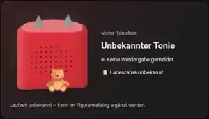
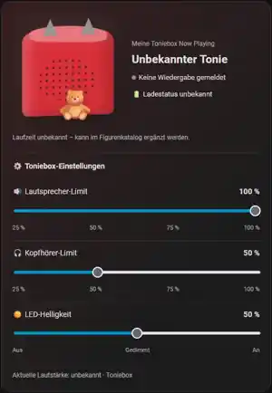
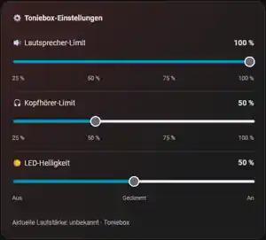

# 🧸 TeddyCloud Home Assistant Integration


**Toniebox-Status und Einstellungen direkt in Home Assistant – über TeddyCloud MQTT.**

**TeddyCloud Home Assistant Integration** bindet Tonieboxen über TeddyCloud und die vorhandene MQTT-Integration in Home Assistant ein. Angezeigt werden unter anderem der aktuelle Titel, der gemeldete Wiedergabestatus und – sofern verfügbar – Figurenbilder und Laufzeiten. Lautstärkelimits und LED-Helligkeit lassen sich ebenfalls über Home Assistant einstellen.

Die Einrichtung ist bewusst einfach gehalten: Toniebox automatisch suchen oder manuell hinzufügen, Boxfarbe auswählen und die gewünschte Karte ins Dashboard einfügen.

> **Hinweis:** Das Projekt ist eine inoffizielle Community-Integration und befindet sich noch in der Weiterentwicklung. Es gibt Funktionen, die je nach TeddyCloud-Version und Tonie nicht immer verfügbar sind. Bitte vor größeren Updates ein Backup machen.

## ✨ Funktionen

| Funktion | Beschreibung |
| --- | --- |
| 🔎 Toniebox automatisch finden | Sucht über MQTT nach Tonieboxen; alternativ kann die Box-ID manuell eingetragen werden |
| 🎨 Boxfarbe auswählen | Bei der Einrichtung eine Farbe auswählen oder später ändern |
| 🎵 Titel und Wiedergabe | Zeigt den gemeldeten Titel, die Audio-ID und den Wiedergabestatus |
| 🧸 Tonie-Bilder | Versucht das passende Bild anhand der Audio-ID aus dem Tonies-Katalog zu laden und lokal zu speichern |
| ⏱️ Laufzeit | Zeigt, wenn verfügbar, die Kataloglaufzeit und einen **geschätzten** Fortschritt |
| 🔊 Aktuelle Lautstärke | Wird als Prozentwert angezeigt – **nicht fernsteuerbar** |
| 👂 Ohrtasten | Großes und kleines Ohr als eigene Sensoren; erkennt einfache, doppelte und dreifache Tastendrücke |
| 🎚️ Lautstärkelimits | Lautsprecher- und Kopfhörerlimit auf 25, 50, 75 oder 100 % einstellen |
| 💡 LED-Helligkeit | Aus, gedimmt oder an |
| 🔌 Ladestation | Zeigt den von TeddyCloud gemeldeten Ladestationsstatus |
| 🖥️ Dashboard | Eine gemeinsame Karte oder getrennte Karten für Wiedergabe und Einstellungen |
| 📦 Mehrere Tonieboxen | Jede Box kann als eigener Integrationseintrag eingerichtet werden |

**Aktuelle Einschränkungen:** Play/Pause über diese Integration steuern, den tatsächlichen Akku-Prozentstand zuverlässig auslesen oder die echte Wiedergabeposition anzeigen. Ein gemeldeter Ladestationsstatus ist auch keine sichere Aussage darüber, ob der Akku gerade geladen wird.

## 📸 Dashboard-Vorschau

Die folgenden Screenshots zeigen die drei Kartenansichten in Home Assistant. Der äußere Dashboard-Hintergrund wurde für eine übersichtlichere Darstellung entfernt.

| Nur Wiedergabe | Alles zusammen | Nur Einstellungen |
| :---: | :---: | :---: |
|  |  |  |
| `mode: player` | `mode: all` | `mode: settings` |

## 📦 Voraussetzungen

- **Home Assistant** mit eingerichteter [MQTT-Integration](https://www.home-assistant.io/integrations/mqtt/)
- Einen funktionierenden [TeddyCloud-Server](https://github.com/toniebox-reverse-engineering/teddycloud), der Toniebox-Daten über MQTT veröffentlicht
- **HACS** zur einfachen Installation (oder eine manuelle Installation der Custom-Integration)
- Für automatische Figurenbilder und Laufzeiten: Internetzugriff von Home Assistant auf den öffentlichen Tonies-Katalog

**Zusätzliche MQTT-Zugangsdaten sind nicht erforderlich.** Die Integration nutzt die bereits eingerichtete MQTT-Verbindung von Home Assistant.

## 🚀 Installation über HACS

1. Öffne **HACS** in Home Assistant.
2. Gehe auf **⋮ → Benutzerdefinierte Repositories**.
3. Füge diese Adresse ein und wähle als Typ **Integration**:

   ```text
   https://github.com/mirkohd1999/TeddyCloud-Home-Assistant-Integration
   ```

4. Suche in HACS nach **TeddyCloud Home Assistant Integration** und lade die Integration herunter.
5. **Starte Home Assistant neu.**
6. Gehe zu **Einstellungen → Geräte & Dienste → Integration hinzufügen** und wähle **TeddyCloud Home Assistant Integration**.

**Manuelle Installation:** Kopiere den Ordner `custom_components/teddycloud_homeassistant` nach `/config/custom_components/` und starte Home Assistant neu.

## 🔎 Toniebox einrichten

### Automatisch suchen

1. Wähle **„Toniebox automatisch suchen“**.
2. Schalte die Toniebox ein oder stelle eine Figur darauf, damit MQTT-Nachrichten gesendet werden.
3. Das MQTT-Präfix kannst du frei eintragen, zum Beispiel `teddyCloud` oder `meinTeddy`. Wenn du es leer lässt, sucht die Integration nach verschiedenen Präfixen.
4. Sobald eine Box erkannt wird, beendet die Suche sich automatisch. Falls keine Nachricht ankommt, stoppt sie nach spätestens **25 Sekunden**.
5. Wähle die gefundene Box aus und vergib einen Namen, zum Beispiel **Meine Toniebox**.
6. Wähle direkt die passende **Boxfarbe** aus.

Falls keine Toniebox auftaucht, kannst du die Einrichtung erneut starten oder die **Box-ID manuell eingeben**.

> Die Suche kann nur Boxen entdecken, von denen MQTT-Meldungen eintreffen oder für die passende gespeicherte (retained) Meldungen vorliegen. Ist die Box komplett still, kann die Suche auch bei funktionierendem MQTT ohne Treffer enden.

### Farben später ändern

Öffne **Einstellungen → Geräte & Dienste → TeddyCloud Home Assistant Integration → Konfigurieren**. Dort kannst du die Farbe auch nachträglich als Hex-Wert einstellen.

## 🖥️ Dashboard-Karte hinzufügen

Öffne dein Dashboard, klicke auf **Bearbeiten → Karte hinzufügen → Manuell** und füge den passenden YAML-Code ein.

### Toniebox mit Titel und Bild

```yaml
type: custom:teddycloud-homeassistant-card
entity: media_player.meine_toniebox_now_playing
name: Meine Toniebox
mode: player
artwork_mode: auto
composition: true
```

### Nur die Einstellungen

```yaml
type: custom:teddycloud-homeassistant-card
entity: media_player.meine_toniebox_now_playing
mode: settings
```

### Toniebox und Einstellungen zusammen

```yaml
type: custom:teddycloud-homeassistant-card
entity: media_player.meine_toniebox_now_playing
name: Meine Toniebox
mode: all
artwork_mode: auto
```

**Wichtig:** `media_player.meine_toniebox_now_playing` ist nur eine Beispiel-Entitäts-ID. Hier muss die **eigene Media-Player-Entitäts-ID** eingetragen werden. Sie steht unter **Einstellungen → Geräte & Dienste → Entitäten**.

Der angezeigte Name entspricht dem bei der Einrichtung gewählten Boxnamen, beispielsweise **Meine Toniebox**. Bestehende Entitäts-IDs mit `_now_playing` bleiben aus Kompatibilitätsgründen erhalten.

### Bilddarstellung

Die Karte unterstützt drei Varianten:

- `artwork_mode: auto` – Katalogbilder werden sicherheitshalber als Cover angezeigt; ein ausdrücklich gesetztes Figurenbild kann als Figur dargestellt werden.
- `artwork_mode: figure` – Bild vor der stilisierten Toniebox anzeigen.
- `artwork_mode: cover` – Bild als eigenständiges Cover anzeigen.

Du kannst auch `composition: false` verwenden, wenn du keine stilisierte Box möchtest. Die normale Einstellung ist `composition: true`. Mit `color: '#D82F38'` kannst du eine Kartenfarbe fest vorgeben; ohne diesen Eintrag wird die in der Integration ausgewählte Farbe verwendet.

## 👂 Große und kleine Ohrtaste als Sensoren

Die Integration stellt für jede eingerichtete Toniebox jetzt zwei zusätzliche **lesende Sensoren** bereit:

- **Großes Ohr (lauter)** – MQTT-Topic `{prefix}/box/{box_id}/VolUp`
- **Kleines Ohr (leiser)** – MQTT-Topic `{prefix}/box/{box_id}/VolDown`

Der Sensorzustand zeigt die letzte erkannte Betätigung: `pressed`, `double-pressed` oder `triple-pressed`. TeddyCloud sendet dafür eine MQTT-Nachricht wie `{"event_type":"pressed"}`.

Die Sensorattribute `last_pressed` (Zeitpunkt) und `press_count` (Anzahl der seit dem letzten Start empfangenen Ereignisse) werden bei **jedem** Tastendruck aktualisiert. Dadurch lassen sich auch wiederholte einfache Tastendrücke in Automationen erkennen. Der Zähler beginnt nach einem Neustart der Integration wieder bei null.

Für eine Home-Assistant-Automation kann zum Beispiel auf Änderungen des Attributs `press_count` reagiert werden:

```yaml
triggers:
  - trigger: state
    entity_id: sensor.DEINE_GROSSES_OHR_ENTITAET
    attribute: press_count
actions:
  - action: persistent_notification.create
    data:
      message: "Großes Ohr wurde gedrückt"
```

Die tatsächlich vergebenen Sensor-Entitäts-IDs stehen unter **Einstellungen → Geräte & Dienste → Entitäten**. Beim ersten Start bleibt der Sensor auf `unknown`, bis TeddyCloud einen Tastendruck meldet. Die MQTT-Daten müssen dafür vom TeddyCloud-Server übertragen werden. Die neuen Sensoren lösen selbst **keine Lautstärkeänderung** aus.

## 🧸 Figurenbilder und Laufzeiten

Wenn die Toniebox eine **Audio-ID** über MQTT meldet, versucht die Integration im öffentlichen [tonies-json-Katalog](https://github.com/toniebox-reverse-engineering/tonies-json) den passenden Eintrag zu finden. Dabei wird anhand der **Audio-ID** gesucht, nicht einfach irgendein Bild anhand eines ähnlichen Titels genommen.

Wenn ein Bild gefunden und heruntergeladen werden kann, wird es unter folgendem Pfad zwischengespeichert:

```text
/config/www/teddycloud_homeassistant/figures/
```

Wenn eine Laufzeit im Katalog hinterlegt ist, wird sie angezeigt. Der Fortschrittsbalken bleibt allerdings eine **Schätzung ab einem MQTT-Wiedergabeereignis** – die Integration bekommt keine echte Position aus dem Hörspiel.

Fehlt ein Katalogeintrag, die Bilddatei oder die Internetverbindung, zeigt Home Assistant möglicherweise ein Ersatzbild oder **„Laufzeit unbekannt“**. Auch bei Kreativ-Tonies oder Sondereditionen können Daten fehlen.

### Eigene Daten ergänzen (optional)

In den **Integrationsoptionen** kannst du einzelne Tonies anhand ihrer Audio-ID selbst ergänzen. Beispiel für das Feld **„Katalog als JSON“**:

```json
{
  "1589539605": {
    "title": "Yakari - Best of Kleiner Donner",
    "duration_seconds": 2340
  }
}
```

Du kannst zusätzlich eine eigene Bild-URL als `figure` oder `cover` hinterlegen. Diese Möglichkeit ist optional – für die normale Einrichtung musst du keinen JSON-Katalog pflegen.

Wenn TeddyCloud Bilder als `http://localhost/...` meldet, kann das im Home-Assistant-Browser nicht direkt funktionieren. Unter den Integrationsoptionen gibt es dafür die **TeddyCloud-Adresse für Coverbilder**, mit der solche Adressen auf den tatsächlich erreichbaren Server umgeschrieben werden können.

## 🛠️ Wenn etwas nicht funktioniert

**Die automatische Suche findet nichts:** Stelle eine Figur auf, aktiviere die Toniebox und überprüfe, ob unter deinem Präfix MQTT-Meldungen ankommen, zum Beispiel `teddyCloud/box/DEINE_BOX_ID/Playback`. Alternativ die Box-ID manuell eintragen.

**Die Dashboard-Karte erscheint nicht („Custom element doesn't exist“):** Prüfe, ob die Integration korrekt installiert wurde, starte Home Assistant neu und lade das Dashboard mit **Strg + F5** neu. Unter **Einstellungen → Dashboards → Ressourcen** muss die Kartenressource als **JavaScript-Modul** vorhanden sein:

```text
/teddycloud-homeassistant/card.js
```

Die Integration versucht, die Ressource bei Dashboards im Storage-Modus automatisch zu registrieren. In YAML-Konfigurationen kann es nötig sein, sie selbst einzutragen. Eine bestehende Ressource bitte bearbeiten, statt doppelte Einträge anzulegen. Zur Fehlerprüfung kannst du die Adresse direkt in deinem Home-Assistant-Browser öffnen.

**Titel vorhanden, aber Bild oder Laufzeit fehlen:** Öffne **Entwicklerwerkzeuge → Zustände** und wähle deine Toniebox-Media-Player-Entität. Diese Attribute helfen bei der Suche:

| Attribut | Bedeutung |
| --- | --- |
| `content_audio_id` | Von TeddyCloud gemeldete Audio-ID |
| `catalog_status` | Status der Online-Suche, z. B. `matched`, `unavailable` oder `audio_id_not_found` |
| `catalog_match` | Ob ein passender Eintrag gefunden wurde |
| `cover_url` | Verwendete Bildadresse |
| `media_duration` | Laufzeit, wenn verfügbar, in Sekunden |
| `duration_source` | Herkunft der Laufzeit |
| `charger` | Von TeddyCloud gemeldeter Ladestationsstatus |

Bei `catalog_status: unavailable` helfen die Meldungen unter **Einstellungen → System → Protokolle**. Bei einem fehlgeschlagenen Katalogabruf versucht die Integration es für die aktuelle Figur erneut, solange sie noch erkannt wird. **Bitte nicht auf „Zustand setzen“ klicken** – damit wird nur der angezeigte Zustand überschrieben, nicht die eigentliche Ursache behoben.

**Die Regler ändern nichts:** Die MQTT-Befehle können je nach TeddyCloud-/Toniebox-Konfiguration erst bei einem späteren *Freshness Check* wirksam werden. Prüfe, ob TeddyCloud die passenden Befehls- und Status-Topics unterstützt.

## 🔄 Aktualisieren und entfernen

**Aktualisieren:** In **HACS → TeddyCloud Home Assistant Integration → Erneut herunterladen**, anschließend Home Assistant neu starten. Falls die Karte noch alt aussieht, das Dashboard neu laden. Vor größeren Änderungen empfiehlt sich ein Backup.

**Entfernen:** Entferne die Integration unter **Einstellungen → Geräte & Dienste**. Wenn die **letzte** eingerichtete Toniebox entfernt wird, bereinigt die Integration ihre lokal gespeicherten Figurenbilder, den internen Cache und automatisch angelegte Dashboard-Ressourcen, sofern deren Eigentum eindeutig gespeichert wurde.

**Bewusst nicht gelöscht** werden selbst angelegte Dashboard-Karten, manuell eingerichtete Ressourcen und andere persönliche Dateien. Ältere Ressourcen müssen gegebenenfalls einmal von Hand entfernt werden.

## 💬 Fehler melden und mithelfen

Fehlerberichte, Verbesserungsvorschläge und Ideen sind willkommen. Dafür einfach ein [GitHub-Issue](https://github.com/mirkohd1999/TeddyCloud-Home-Assistant-Integration/issues) erstellen.

Hilfreich sind dabei die Versionen von Home Assistant und TeddyCloud, der beobachtete Fehler sowie passende Protokollmeldungen. Bitte **keine Passwörter, Zugangstoken, Zertifikate oder privaten MQTT-Daten** veröffentlichen.

## ℹ️ Hinweise

Dies ist **kein offizielles Projekt von tonies® oder TeddyCloud**. Die Rechte an den Tonie-Figuren und deren Bildern liegen bei den jeweiligen Rechteinhabern. Die optionalen Online-Bilder/Katalogdaten werden über Drittanbieterquellen abgerufen; dafür muss Home Assistant diese Server erreichen können.

Die interne Integrationskennung bleibt `teddycloud_homeassistant`, um bestehende Installationen und Dashboard-Entitäten möglichst kompatibel zu halten.

Das eigene Integrationslogo mit Toniebox und Teddy liegt im `brand/`-Ordner. Für dessen Darstellung in Home Assistant ist eine ausreichend neue Home-Assistant-Version erforderlich.

## 📄 Lizenz

Dieses Projekt steht unter der [MIT-Lizenz](LICENSE).
